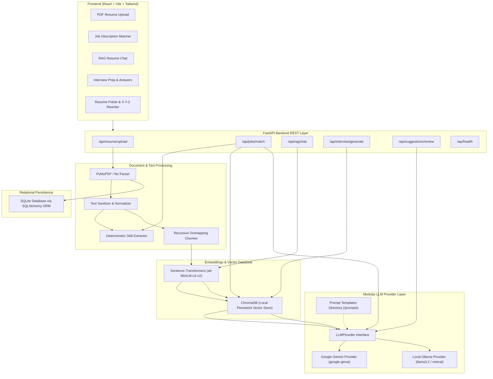

# ⚡ AI Career & Resume Assistant

> **A Modular Generative AI & RAG Career Assistant for Freshers & AI Portfolio**
> 
> *Supports **Google Gemini API** (via official `google-genai` SDK) and **Local Ollama**, with local **Sentence-Transformers**, **ChromaDB**, **FastAPI**, and **React + Vite**.*

---

## 📌 Project Overview

The **AI Career & Resume Assistant** is a practical, full-stack Generative AI application engineered to demonstrate document ingestion, semantic chunking, dense vector embeddings, vector similarity search, anti-hallucination RAG pipelines, deterministic skill parsing, and modular LLM orchestration.

Key features:
1. **Document Processing Pipeline**: Ingestion of raw PDF resumes, ligature normalization, control character sanitization, and overlapping chunking.
2. **Local Vector Search**: Zero-cost semantic retrieval using `sentence-transformers/all-MiniLM-L6-v2` and persistent `ChromaDB`.
3. **Grounded RAG Resume Chatbot**: Strict context injection that cites exact document chunks with cosine similarity scores and refuses to hallucinate unmentioned facts.
4. **Deterministic + LLM Job Description Matcher**: High-precision skill taxonomy comparison combined with vector-based project matching and hiring manager coaching.
5. **Interview Question & STAR Answer Generator**: Automated generation of technical, architecture, SQL/Python, and behavioral questions grounded in real resume projects.
6. **Google X-Y-Z Bullet Point Polish**: Transformation of passive job duty descriptions into quantifiable, outcome-driven metrics (*"Accomplished [X] as measured by [Y] by doing [Z]"*).
7. **Modular LLM Architecture**: Pluggable LLM provider abstraction supporting **Google Gemini API** and **Local Ollama**.

---

## 🏛️ System Architecture



---

## 🤖 LLM Provider Configuration

The project features a clean `LLMProvider` abstraction allowing seamless switching between providers without modifying any business logic.

### 1. Google Gemini API (Primary)
Set in `.env`:
```bash
LLM_PROVIDER=gemini
GEMINI_API_KEY=your_key_here
GEMINI_MODEL=gemini-3.1-flash-lite
```
*(Uses the official `google-genai` Python SDK. The API key is loaded strictly on the backend and is never exposed to the frontend or logs).*

### 2. Local Ollama (Optional Local Provider)
Set in `.env`:
```bash
LLM_PROVIDER=ollama
OLLAMA_BASE_URL=http://localhost:11434
OLLAMA_MODEL=llama3.2
```

---

## 🚀 Core Features

| Feature | Description | Technical Implementation |
| :--- | :--- | :--- |
| **1. Resume Upload & Ingestion** | Upload candidate PDF resume; extract clean text; categorize 200+ technical skills; chunk and index text. | `PyMuPDF`, regex normalization, `sentence-transformers`, `ChromaDB`, `SQLite`. |
| **2. Resume-JD Gap Analysis** | Paste job descriptions to see exact matching vs missing skills, plus semantic project alignment. | Deterministic taxonomy overlap + Cosine similarity vector search + LLM coaching advice. |
| **3. Grounded RAG Chat** | Chat with the resume ("What AWS projects did I build?"). Answers cite exact chunks with similarity scores. | Query embedding → Top-K vector retrieval → Anti-hallucination prompt → Gemini / Ollama generation. |
| **4. Interview Question Prep** | Generates categorized interview questions (Technical, Architecture, SQL/Python, Behavioral). | Project context extraction + LLM structured JSON generation + STAR answer template synthesis. |
| **5. Resume Polish & X-Y-Z Rewriter** | Reviews resume for missing metrics & rewrites bullets into Google's X-Y-Z formula. | Modular prompt engineering with measurable placeholder metrics. |

---

## 🧠 GenAI & RAG Concepts Explained (Interview Guide)

### 1. What are Embeddings?
An **embedding** is a numerical representation of text as a dense vector of floating-point numbers (e.g., 384 dimensions for `all-MiniLM-L6-v2`). Text segments with similar semantic meaning are mapped close to each other in vector space, allowing mathematical calculation of meaning regardless of exact wording.

### 2. Why is Vector Search needed instead of SQL `LIKE`?
SQL keyword searches (`WHERE text LIKE '%AWS%'`) only find exact substring matches. Vector search computes the **Cosine Similarity** between query vectors and document chunk vectors:
$$\text{Similarity}(u, v) = \frac{u \cdot v}{\|u\| \|v\|}$$
This enables semantic discovery (e.g. searching for *"cloud data pipelines"* retrieves chunks mentioning *"Amazon S3, Lambda, and Glue"* even if the exact phrase was never used).

### 3. Why do we Chunk Documents?
1. **Context Window Optimization**: LLMs have limited context limits and perform best with concise, highly relevant information.
2. **Retrieval Precision**: Embedding an entire 3-page resume produces an average vector that blurs specific project details. Chunking (e.g., 450 characters with 60-character overlap) preserves granular context for each project.

### 4. How does RAG Prevent Hallucinations?
Standard LLMs generate text based on probabilistic patterns learned during pre-training, which causes them to invent facts ("hallucinate"). In our RAG pipeline:
1. The model is given **only** the retrieved resume excerpts.
2. The system prompt strictly constrains the LLM: *"If the answer cannot be found in the Resume Context, respond EXACTLY with: 'I couldn't find this information in the uploaded resume.' Do not invent projects, dates, or technologies."*

---

## 🛠️ Technology Stack

- **Backend**: Python 3.12, FastAPI, Pydantic v2, SQLAlchemy, SQLite
- **AI & Retrieval**: Google Gemini (`google-genai`), Local Ollama, `sentence-transformers` (`all-MiniLM-L6-v2`), `ChromaDB` (Persistent)
- **Document Extraction**: `PyMuPDF` (`pymupdf`)
- **Frontend**: React 18, Vite, Tailwind CSS, Lucide Icons
- **Testing**: `pytest`, `pytest-asyncio`, `httpx`

---

## 📦 Getting Started (Local Setup)

### Prerequisites
1. **Python 3.10+**
2. **Node.js 18+ & npm**
3. **Google Gemini API Key** (or local **Ollama**)

### Step 1: Clone & Configure Environment
```bash
# Copy example configuration
cp .env.example .env

# Edit .env and configure your provider
# LLM_PROVIDER=gemini
# GEMINI_API_KEY=your_key_here
```

### Step 2: Start Backend Server
```bash
# Navigate to project root
cd ai-career-assistant

# Install backend dependencies
pip install -r backend/requirements.txt

# Start FastAPI server with live reload
uvicorn backend.app.main:app --reload --port 8000
```
Backend API will be live at `http://localhost:8000` (Interactive Swagger Docs at `http://localhost:8000/docs`).

### Step 3: Start React Frontend
In a separate terminal:
```bash
cd ai-career-assistant/frontend

# Install frontend dependencies
npm install

# Start Vite dev server
npm run dev
```
Frontend UI will be running at `http://localhost:3000`.

---

## 🧪 Automated Testing

Run the 21 automated unit and integration tests covering Gemini provider mocking, PDF parsing, skill extraction, vector indexing, RAG retrieval, and FastAPI routes:
```bash
pytest tests/ -v
```

---

## 📡 REST API Reference

| Method | Endpoint | Description |
| :--- | :--- | :--- |
| `GET` | `/api/health` | Returns backend health, database status, and configured LLM provider status |
| `POST` | `/api/resume/upload` | Uploads PDF resume, extracts text, identifies skills, and generates ChromaDB chunks |
| `GET` | `/api/resume/list` | Returns list of all indexed resumes |
| `GET` | `/api/resume/{id}` | Returns full parsed text and skill catalog for a resume |
| `DELETE`| `/api/resume/{id}` | Deletes resume record and associated vector embeddings |
| `POST` | `/api/jobs/analyze` | Extracts skills and requirements from a Job Description |
| `POST` | `/api/jobs/match` | Runs deterministic skill match + vector search + LLM analysis |
| `POST` | `/api/rag/chat` | Answers questions strictly using retrieved resume context |
| `POST` | `/api/interview/generate` | Generates realistic interview questions tailored to resume projects |
| `POST` | `/api/interview/answer` | Generates STAR-method sample answer grounded in candidate projects |
| `GET` | `/api/suggestions/review/{id}` | Evaluates resume strengths and missing impact metrics |
| `POST` | `/api/suggestions/improve-bullet` | Rewrites bullet points using Google's X-Y-Z formula |

---

## 🎓 Interview Explainability Cheat-Sheet

| Question | Fresher Answer Summary |
| :--- | :--- |
| **How does the LLM abstraction work?** | We define an abstract base class `LLMProvider` with a `generate()` method. `GeminiProvider` and `OllamaProvider` implement this interface. The services interact only with the interface, making the LLM backend interchangeable with zero business-logic changes. |
| **Why FastAPI over Flask/Django?** | FastAPI offers native async support, automatic OpenAPI/Swagger documentation, and Pydantic data validation with high execution performance. |
| **Why SQLite?** | SQLite is serverless, zero-configuration, and stores data in a single local file—ideal for modular standalone applications. |
| **How is API key security handled?** | `GEMINI_API_KEY` is read strictly from backend environment variables, never logged, never returned by APIs, and never present in client-side bundles. |

---

## 📜 License
MIT License. Built for educational and portfolio demonstration purposes.
